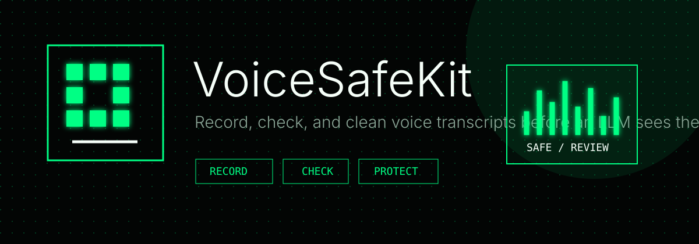
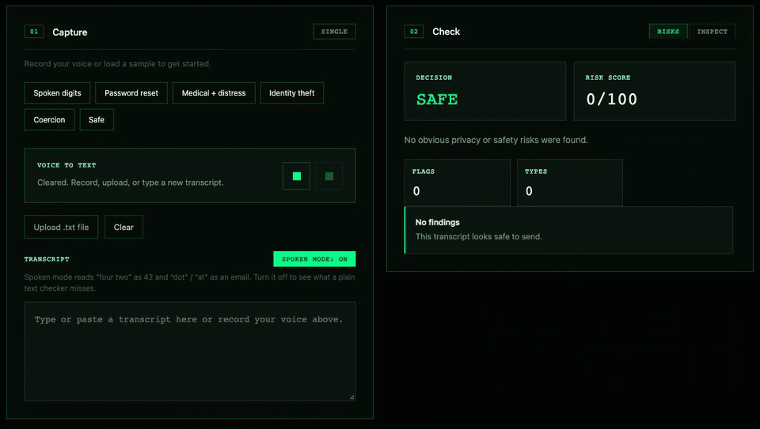
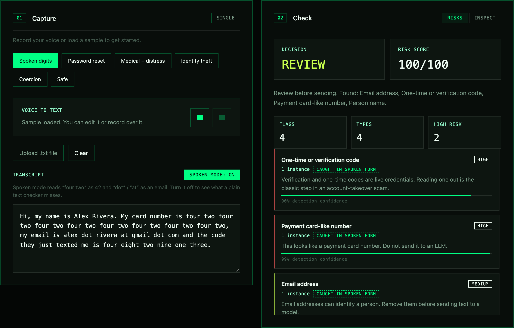
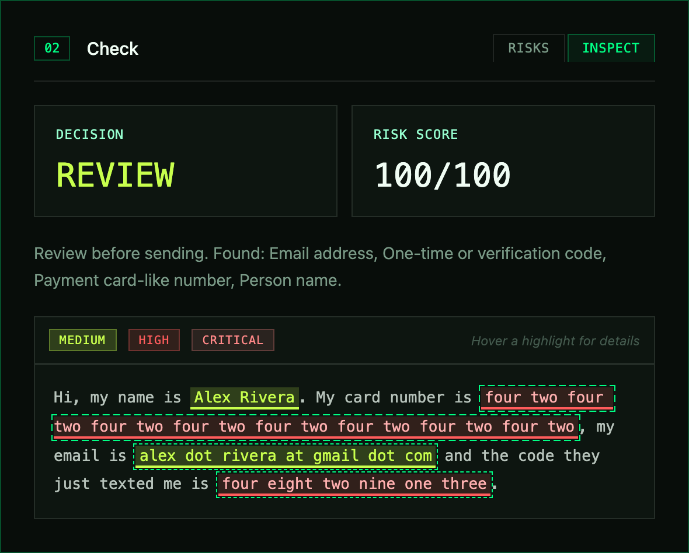
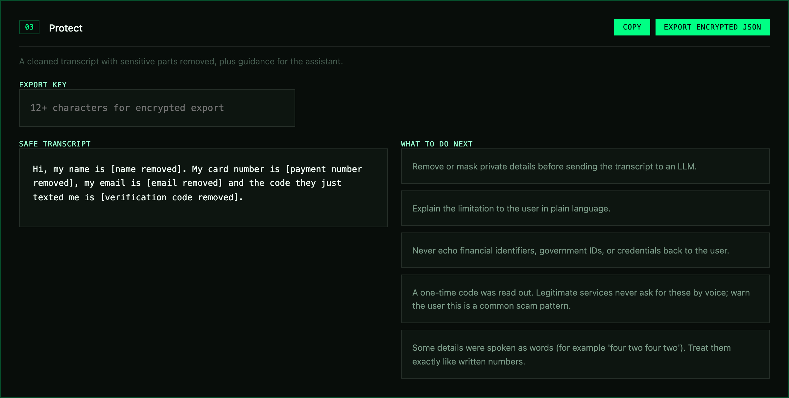
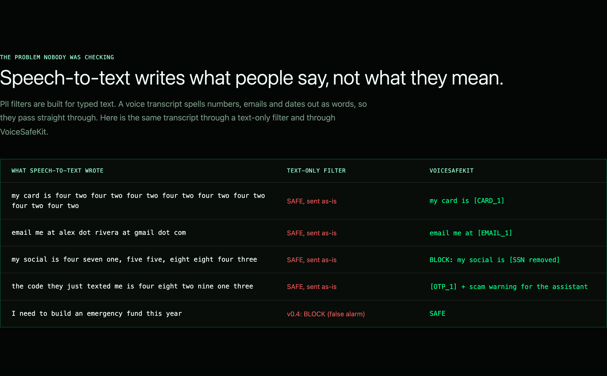

<p align="center">
  
</p>

<p align="center">
  <a href="https://github.com/MohamadKanso/VoiceSafeKit/actions/workflows/ci.yml"></a>
  
  
  
</p>

<p align="center">
  <a href="https://mohamadkanso.github.io/VoiceSafeKit/"><strong>Try it in your browser</strong></a>
  ·
  <a href="#spokenpii-benchmark"><strong>Benchmark</strong></a>
  ·
  <a href="#pipecat">Pipecat</a>
  ·
  <a href="#livekit-agents">LiveKit</a>
  ·
  <a href="#open-webui">Open WebUI</a>
  ·
  <a href="#litellm">LiteLLM</a>
  ·
  <a href="#bleep-the-recording-not-just-the-transcript">Audio</a>
  ·
  <a href="https://github.com/MohamadKanso/VoiceSafeKit/blob/main/CHANGELOG.md">Changelog</a>
</p>

# VoiceSafeKit

**Your voice agent is sending card numbers to the LLM, and your PII filter can't see them.**

<p align="center">
  
  <br>
  <sub>A voice says a card number and an email into the <a href="https://mohamadkanso.github.io/VoiceSafeKit/">live app</a>. Whisper runs on-device and both are caught. Recording sped up 5×.</sub>
</p>

Speech-to-text writes what people *say*, not what they *mean*:

```text
my card is four two four two four two four two four two four two four two four two
email me at alex dot rivera at gmail dot com
call me on oh seven seven double oh nine double oh one two three
```

Regex filters and NER models (Presidio, most guardrail libraries) are built for written
text, so they pass all three straight through. VoiceSafeKit reads speech the way STT
writes it, redacts the sensitive parts, and gives the values back when the agent needs
to say them. It can also bleep them out of the call recording. Zero dependencies, about
0.06 ms per utterance, and drop-ins for **Pipecat**, **LiveKit Agents**, **Open WebUI** and
**LiteLLM**.

```text
User says    : Hi, my name is Alex Rivera. My card number is four two four two four two four two
               four two four two four two four two and my email is alex dot rivera at gmail dot com.
LLM receives : Hi, my name is [NAME_1]. My card number is [CARD_1] and my email is [EMAIL_1].
TTS says     : Thanks Alex Rivera. I'll send the receipt to alex dot rivera at gmail dot com.
```

<sub>Output of `examples/pipecat/offline_demo.py`, which runs without API keys.</sub>

## Install

```bash
pip install voicesafekit
# or, before the first PyPI release: pip install git+https://github.com/MohamadKanso/VoiceSafeKit
# extras: [pipecat] [livekit] [openwebui] [litellm] [audio] [crypto]
```

```bash
echo "my pin is four eight two one" | voicesafekit redact
# my pin is [PIN removed]
```

## See it

Spoken PII caught in the [live app](https://mohamadkanso.github.io/VoiceSafeKit/), with no
digits or @ signs anywhere in the transcript:

<p align="center">
  
</p>

<table>
  <tr>
    <td width="50%"></td>
    <td width="50%"></td>
  </tr>
  <tr>
    <td><sub>Inspect: the exact spoken words that were flagged.</sub></td>
    <td><sub>Protect: the safe transcript and guidance for the assistant.</sub></td>
  </tr>
</table>

<p align="center">
  
</p>

## SpokenPII benchmark

No public benchmark measures PII *as speech-to-text writes it*, so this repo ships one.

**Held-out real speech (the honest number).** New scripts read aloud by a British TTS
voice (`Daniel`), transcribed by faster-whisper `small.en`, frozen before any 0.6 change
and never used for tuning. A sample counts as protected only if the value can't be
recovered from the redacted transcript.

| Detector | PII protected (not leaked) | False alarms on no-PII |
|---|---:|---:|
| **VoiceSafeKit 0.6** | **98%** (106/108) | **2%** (1/40) |
| VoiceSafeKit 0.5 | 94% (102/108) | 2% (1/40) |
| VoiceSafeKit 0.6, spoken mode off | 87% (94/108) | 2% (1/40) |
| Microsoft Presidio 2.2 | 65% (70/108) | 42% (17/40) |

The three failures are published in
[#9](https://github.com/MohamadKanso/VoiceSafeKit/issues/9): a PIN Whisper wrote as money
(`$4,990`), a comma before the birth year, and a mangled date read as a phone number.

<details>
<summary>First real-speech set (Samantha voice, Whisper base.en)</summary>

v0.5 protected 101/108 on this set. Its 7 misses (comma-split digit groups, `SSN609507896`,
digits written as decimals, "fin" for PIN) were fixed in 0.6
([#6](https://github.com/MohamadKanso/VoiceSafeKit/issues/6)), so 0.6 now scores 108/108
here. Because the fixes were written against these misses, this set is no longer held out.
Presidio: 79/108, 17/40 false alarms.

</details>

**SpokenPII (synthetic).** 540 labelled sentences, the same values written two ways, plus
40 tricky no-PII requests ("emergency fund", "call Sue", "twenty five minutes"). A span
counts as protected only if at least 90% of it is masked.

| Detector | Written PII protected | Spoken PII protected | False alarms on no-PII | Median latency |
|---|---:|---:|---:|---:|
| **VoiceSafeKit 0.6** | **100%** | **100%** | **0%** | **0.06 ms** |
| VoiceSafeKit 0.6, spoken mode off | 100% | 11% | 0% | 0.04 ms |
| Microsoft Presidio 2.2 (spaCy `en_core_web_lg`) | 86% | 21% | 45% | ~3 ms |

Spoken PII protected, by type:

| Type | VoiceSafeKit | Presidio |
|---|---:|---:|
| Card number | 100% | 0% |
| SSN | 100% | 3% |
| Phone | 100% | 0% |
| Email | 100% | 0% |
| PIN | 100% | 13% |
| One-time code | 100% | 3% |
| Passport | 100% | 0% |
| Date of birth | 100% | 77% |
| Name | 100% | 97% |

**Read these numbers honestly.** I wrote the synthetic set and the detector, so 100% there
mostly shows the templates are covered; the held-out real-speech set is the fairer test. Presidio is a
general-purpose tool configured with its defaults, not tuned for speech. Its false alarms
are mostly `DATE_TIME` and `PERSON` hits on ordinary requests. Reproduce everything with
`python benchmarks/run.py --presidio` and
`python benchmarks/asr.py score --presidio --data benchmarks/data/spokenpii-asr-heldout.jsonl`.
Better still, add transcripts from your own STT engine.

## What it catches

| Category | Detectors |
|---|---|
| Spoken forms | digits as words, "oh" / "double" / "triple", "plus four four", tens and hundreds, spoken emails, spoken dates |
| Payment | card number (Luhn + context), partial card ("ends in 4821"), CVV, PIN, IBAN (mod-97) |
| Identity | SSN (with or without dashes), passport, UK National Insurance, date of birth, self-introduced name |
| Contact | email, phone, street address, UK postcode, IP address |
| Credentials | passwords and secrets in speech, one-time / verification codes, API keys (OpenAI, AWS, GitHub, Slack, Google) |
| Safety signals | emergency, emotional distress, coercion, medical / legal / financial advice requests |

Every result has a `decision` (`SAFE`, `REDACT`, `REVIEW`, `BLOCK`), a 0-100 `score`,
per-finding `confidence` and `spoken` flags, a `safe_transcript`, a `redaction_map` and
plain-English `assistant_guidance`.

## Python API

```python
from voicesafekit import analyze_transcript

result = analyze_transcript("my social is four seven one, five five, eight eight four three")
result.decision            # "BLOCK"
result.safe_transcript     # "my social is [SSN removed]"
result.findings[0].spoken  # True
```

### Reversible placeholders

Plain redaction breaks agents that need to say "I've sent it to your email". A
`PrivacySession` swaps values for placeholders, keeps the map in memory, and restores
them in the reply, including streamed tokens:

```python
from voicesafekit import PrivacySession

session = PrivacySession()
safe = session.protect("email me at alex dot rivera at gmail dot com")
safe.text                       # "email me at [EMAIL_1]"
reply = llm(safe.text)          # "Done, I've emailed [EMAIL_1]."
session.restore(reply)          # "Done, I've emailed alex dot rivera at gmail dot com."

stream = session.stream()       # for token streams: "[EMA" + "IL_1]" restores correctly
```

The same value gets the same placeholder for the whole conversation, whether it was
spoken or written. **Passwords, PINs, CVVs, one-time codes and API keys are never stored,**
so the model can't make the voice read them back.

## Pipecat

```python
from voicesafekit.integrations.pipecat import voicesafe_processors

guard_in, restore_out, guard_context = voicesafe_processors()

pipeline = Pipeline([
    transport.input(), stt,
    guard_in,             # spoken PII -> [CARD_1], [EMAIL_1] before the LLM
    user_aggregator, llm,
    restore_out,          # real values back for the voice only
    tts, transport.output(),
    guard_context,        # stored assistant replies keep the placeholders
    assistant_aggregator,
])

@guard_in.event_handler("on_block")
async def on_block(processor, protected):
    ...  # emergencies, government IDs, CVVs: never forwarded, refusal is spoken
```

Many STT services send several final transcriptions per turn. When one ends mid-number near
a sensitive word ("my card number is four two four two"), the processor holds it for up to
0.8 s and merges it with the next, so a card number split across frames is still caught.

## LiveKit Agents

```python
from voicesafekit.integrations.livekit import VoiceSafeAgent

class Assistant(VoiceSafeAgent):          # instead of Agent
    def __init__(self):
        super().__init__(instructions="You are a helpful voice assistant.")
```

`VoiceSafeAgent` protects each user turn in `on_user_turn_completed`, restores values in
`tts_node`, and stops blocked turns. `VoiceSafeRedactor().redact(text)` is a stateless,
idempotent redactor for transcript and log hooks. Full example: `examples/livekit/agent.py`.

## Open WebUI

A Filter Function: **Admin Panel > Functions > + > paste
[`examples/openwebui/voicesafekit_filter.py`](https://github.com/MohamadKanso/VoiceSafeKit/blob/main/examples/openwebui/voicesafekit_filter.py) > Save**,
then enable it. It installs VoiceSafeKit through its `requirements:` line.

- Every user message is protected before the model sees it ("my card is four two four
  two ..." becomes "my card is [CARD_1]"), and real values come back in the reply on the
  user's own screen, streamed or not.
- Placeholders stay consistent per chat and per user. A new message carrying a government
  ID, card security code or emergency is stopped with a clear message (valve
  `block_on_critical`).
- Valves: `spoken`, `block_on_critical`, `restore_in_output`, `max_chats`, `priority`.

Open WebUI's background tasks (title, tags, follow-ups, autocomplete) call the task model
directly and skip filters, so turn them off or use a local task model for full privacy.
Built against Open WebUI 0.13 and tested with the request shapes from its source.

## LiteLLM

A custom guardrail for the LiteLLM proxy, so every app behind it gets the same protection:

```yaml
guardrails:
  - guardrail_name: voicesafekit
    litellm_params:
      guardrail: voicesafekit.integrations.litellm.VoiceSafeGuardrail
      mode: [pre_call, post_call]   # redact before the model, restore after (streaming too)
      default_on: true
      block_on_critical: true       # HTTP 400 for government IDs, CVVs, emergencies
```

```bash
pip install "voicesafekit[litellm]"
litellm --config config.yaml
```

Tested on a running LiteLLM 1.108 proxy: the upstream model received `my card is [CARD_1]`,
the client got the real values back (normal and streamed), and an SSN request returned
HTTP 400 without reaching the model. See [`examples/litellm/`](https://github.com/MohamadKanso/VoiceSafeKit/tree/main/examples/litellm/).

## Bleep the recording, not just the transcript

Redacting the transcript still leaves the card number in the call recording. VoiceSafeKit
bleeps it out of the audio too, locally and for free, with standard-library code once you
have word timestamps.

```bash
pip install "voicesafekit[audio]"           # adds faster-whisper for word timestamps
voicesafekit bleep call.wav -o call.bleeped.wav
# Hi, my name is [name removed], my card number is [payment number removed] and my pin is [PIN removed].
#
# Bleeped 3 span(s) -> call.bleeped.wav
#   00:00.950 - 00:01.870  Person name
#   00:02.990 - 00:07.330  Payment card-like number
#   00:07.730 - 00:08.850  PIN
```

Already have word timings from Deepgram, Whisper or WhisperX? Pass them and no extras are
needed:

```python
from voicesafekit.audio import bleep_wav, redact_audio_spans, words_from_deepgram

redaction = redact_audio_spans(words_from_deepgram(response))   # PII -> time spans
bleep_wav("call.wav", "call.bleeped.wav", redaction)            # or mode="silence"
```

Checked end to end: transcribing the bleeped file with Whisper finds no card or PIN digits,
while the rest of the sentence still comes through. PCM WAV (8/16/24/32-bit, any channel count), streamed in
chunks; every sample outside the spans is copied byte for byte.

## OpenVoiceOS

```python
from voicesafekit.integrations.openvoiceos import protect_utterance

result = protect_utterance(utterance)
if result.should_continue:
    send_to_llm(result.safe_transcript)
```

## CLI

```bash
voicesafekit check examples/transcripts/identity_theft.txt --pretty
voicesafekit redact --placeholders < transcript.txt
voicesafekit conversation turn1.txt turn2.txt --pretty
voicesafekit bleep call.wav -o call.bleeped.wav            # needs [audio] or --words
voicesafekit check transcript.txt --out result.enc.json   # AES-256-GCM, needs [crypto]
```

## Browser app

The [live app](https://mohamadkanso.github.io/VoiceSafeKit/) records your voice,
transcribes it with Whisper on your device and runs the same rules in the browser. No
server and no API key, and nothing leaves the page. Say a card number out loud and watch
it disappear.

```bash
python3 -m http.server 8124 --directory docs   # run it locally
```

## Design principles

- **Speech first.** Rules run on what STT actually produces, not on tidy written text.
- **Local and tiny.** Pure Python, no dependencies, no network, no model download.
- **Auditable.** Every finding has a confidence score and maps to exact spans.
- **Fail toward privacy.** Credentials are never stored, blocked turns never reach the model.
- **Honest scope.** It is a fast first layer, not a full privacy programme or a
  compliance certification. Pair it with your own review for PCI DSS, HIPAA or GDPR work.

## Contributing

The most valuable contribution is a transcript your STT engine produced that VoiceSafeKit
missed (fake data only). Use the
[Missed spoken PII](https://github.com/MohamadKanso/VoiceSafeKit/issues/new?template=missed_spoken_pii.yml)
template. See [CONTRIBUTING.md](https://github.com/MohamadKanso/VoiceSafeKit/blob/main/CONTRIBUTING.md) and the [roadmap](https://github.com/MohamadKanso/VoiceSafeKit/blob/main/ROADMAP.md).

```bash
pip install -e ".[dev]" && pytest && python benchmarks/run.py
```

## License

MIT. See [LICENSE](https://github.com/MohamadKanso/VoiceSafeKit/blob/main/LICENSE). Not legal, medical or security advice.
